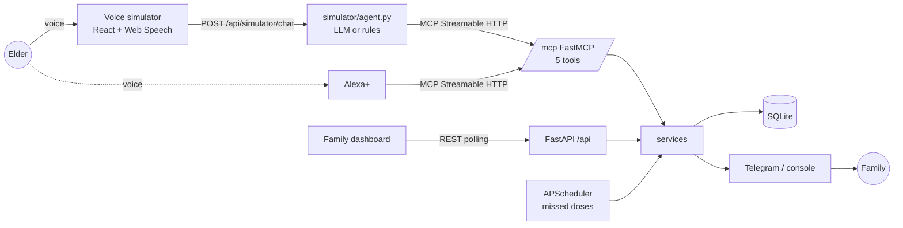

# Saathi (साथी)

**A voice-first elder-care companion for Alexa+.** An elderly person talks ("I took my BP tablet", "I feel dizzy"); Saathi runs behind the voice assistant as a self-hosted **MCP server** (Streamable HTTP, spec 2025-11-25) with five tools, records what happened, and tells family on Telegram the moment something looks wrong. A family dashboard and an elder-friendly voice simulator show everything live, including a **live MCP tool-call log**.

Built for the *Build, Ship, Shape: Amazon Developer Hackathon*, **Alexa+ track**. Total cost: **Rs. 0** (free tiers and open source only).

> Saathi logs and reminds only. It never diagnoses, never advises doses, and never replaces emergency services. All demo data is fictional.

 
<!-- screenshot placeholders: see docs/screenshots/README.md -->

## Quick start (under 5 steps)

```bash
git clone <your-repo-url> saathi && cd saathi
cp .env.example .env          # optional: add TELEGRAM_BOT_TOKEN, GEMINI_API_KEY
make setup                    # creates backend/.venv, installs Python + npm deps
make dev                      # backend :8000, frontend :5173 (seeded demo data)
# open http://localhost:5173/elder  (Chrome or Edge for the microphone)
```
Windows: use `scripts/dev.ps1` instead of `make dev`. Requires Python 3.11+ and Node 20+.

## Try it
- Open `/elder`, tap **I feel unwell**. You get a calm spoken reply, a `report_concern` entry in the tool-call log, a new event and toast on `/family`, and a Telegram message (or a console line if no token is set).
- Open `/family` in a second window to watch it update live.
- Demo at night? Every dose time may already be past. Add a medicine due a few minutes from now in **Care setup**, or run `backend/.venv/bin/python scripts/reset_demo.py`. Set `MISSED_DOSE_MINUTES=1` to see the missed-dose alert quickly.

## Architecture


Details, sequence and ER diagrams: [docs/ARCHITECTURE.md](docs/ARCHITECTURE.md).

## The five MCP tools
| Tool | What it does |
|---|---|
| `get_today_schedule` | Medicines still to take and today's appointments, soonest first (under 40 words) |
| `log_medication_taken` | Fuzzy-matches "BP tablet", stores the dose, rejects duplicates within 30 min |
| `daily_checkin` | Stores `good`/`okay`/`unwell`; `unwell` alerts family |
| `report_concern` | Stores the event and alerts every contact now; high severity adds "call emergency services if it gets worse" |
| `add_appointment` | Validates the date/time and confirms it back in spoken form |

Reference with examples: [docs/API.md](docs/API.md).

## Test the MCP server with MCP Inspector
Start the backend (`make dev`), then:
```bash
# CLI, verified to list exactly the 5 tools
npx @modelcontextprotocol/inspector --cli http://localhost:8000/mcp \
  --transport http --method tools/list --header "X-Saathi-Key: change-me"

# or the visual UI: choose transport "Streamable HTTP", URL http://localhost:8000/mcp,
# and add header X-Saathi-Key (use X-Saathi-Source: inspector to tag the calls in the log)
npx @modelcontextprotocol/inspector
```
Use your own value if you changed `SHARED_SECRET`. Leave it empty to disable auth in local dev.

## Expose it publicly (free)
```bash
cloudflared tunnel --url http://localhost:8000     # or: ngrok http 8000
```
Point your MCP client (Alexa+ or any) at `https://<tunnel-host>/mcp` and send `X-Saathi-Key`. See [docs/ALEXA_PLUS_SETUP.md](docs/ALEXA_PLUS_SETUP.md). Always set a real `SHARED_SECRET` before exposing.

## Telegram alerts (optional)
Create a bot with @BotFather, put the token in `TELEGRAM_BOT_TOKEN`, have each family member press **Start**, then add their chat ID under **Care setup → Family contacts** (the page explains how to find it). Without a token, alerts go to the console and are still saved as events.

## Free LLM brain for the simulator (optional)
`LLM_PROVIDER=gemini|groq` plus the matching key lets an LLM choose the tool using the live tool descriptions from the MCP server. Any error or rate limit falls back to the offline rules engine, so the demo never fails. Default is `rules` (no key needed). Model names are configurable (`GEMINI_MODEL`, `GROQ_MODEL`).

## Project layout
`backend/` FastAPI + FastMCP, layered as `api → services → db/repositories` with `mcp_server/tools` as thin adapters; `frontend/` React 18 + Vite + Tailwind, feature-based. Rules: services never import FastAPI or MCP, repositories own all SQL, config only via `core/config.py`.

## Tests and tooling
`make test` runs pytest (57 tests, including every MCP tool through the real MCP client over Streamable HTTP) and Vitest. `make lint` runs Ruff and ESLint; mypy is configured leniently.

## Safety and privacy
See [docs/SAFETY_AND_PRIVACY.md](docs/SAFETY_AND_PRIVACY.md). Short version: reminders and records only, no medical advice, data stays in a local SQLite file, no analytics, and the elder should consent to family being alerted.

## Tech stack
Python 3.11+, FastAPI, official `mcp` SDK (FastMCP, Streamable HTTP), SQLAlchemy 2, SQLite, rapidfuzz, APScheduler, httpx, Telegram Bot API · React 18, TypeScript, Vite, Tailwind, Radix UI, Framer Motion, TanStack Query, Zustand, React Hook Form + Zod, Recharts, Sonner, date-fns, Atkinson Hyperlegible + Inter.

## Hackathon notes
Track: **Alexa+**. Mini challenge: **Open Source** (MIT, [LICENSE](LICENSE)). The repo calls MCP in code (`backend/app/mcp_server/server.py` builds the FastMCP server, `backend/app/simulator/mcp_client.py` loads `mcp_config.json` and calls `/mcp`). Feedback and friction: [PRODUCT_FEEDBACK.md](PRODUCT_FEEDBACK.md), [FRICTION_LOG.md](FRICTION_LOG.md). Demo video script: [docs/DEMO_SCRIPT.md](docs/DEMO_SCRIPT.md).

## License
MIT. © 2026 Saathi contributors.
