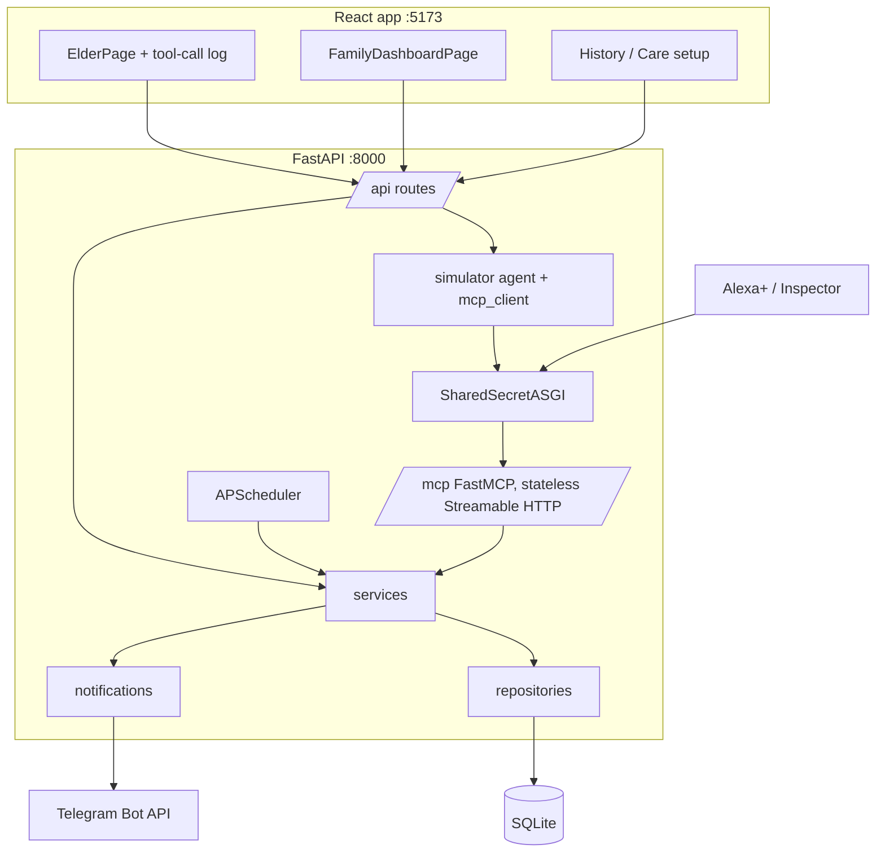
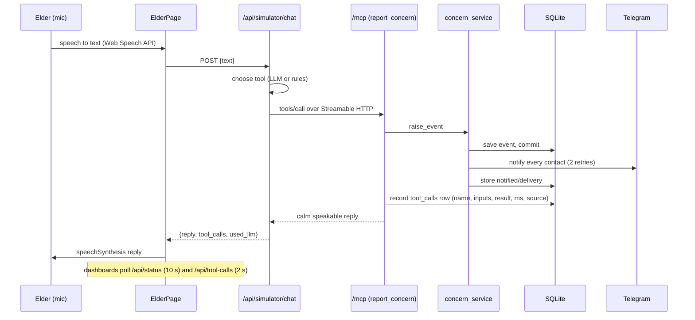
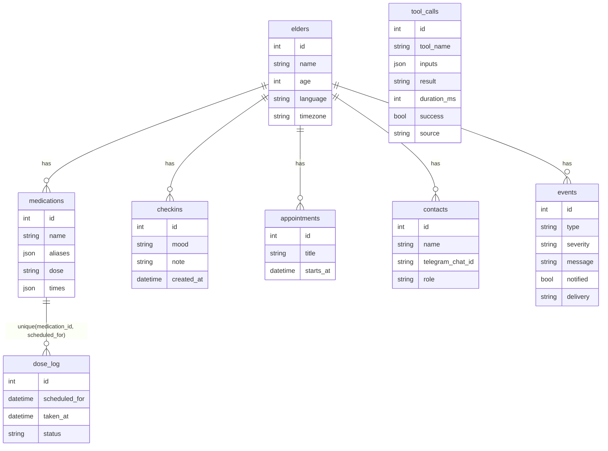

# Architecture

## Components

## Request lifecycle: "I feel dizzy"

## Data model

All datetimes are stored as UTC (a `UTCDateTime` column type rejects naive values) and shown in `TIMEZONE` (default Asia/Kolkata).

## Layer rules
1. `services/` holds all business logic. It never imports FastAPI or MCP.
2. `db/repositories/` owns all SQL; services call repositories.
3. REST routes and MCP tools are thin adapters over services.
4. Config is read only in `core/config.py`.
5. Reply wording lives only in `services/reply_service.py`.
6. Notifiers never raise: delivery failures are reported, the event is already saved.

## MCP SDK version and notes
- Pinned `mcp>=1.30,<2` (installed 1.30.0). `mcp.types.LATEST_PROTOCOL_VERSION` is `2025-11-25`; a raw `initialize` against `/mcp` negotiates `2025-11-25`. The PyPI 2.x line was not used (different API surface).
- Server: `FastMCP(stateless_http=True, json_response=True)`, endpoint `/mcp`, mounted at `/` in FastAPI. A mounted app's lifespan does not run, so `main.py` runs `mcp.session_manager.run()` in the FastAPI lifespan. A session manager can run only once per instance, so `build_mcp()` creates a fresh server per app.
- DNS-rebinding host checks are disabled (tunnel hostnames vary); access control is the `X-Saathi-Key` header enforced by a pure-ASGI guard in `mcp_server/auth.py` (safe for streaming).
- Tools are sync bodies wrapped by `@tracked`, which runs them off the event loop, converts exceptions to a friendly reply, and writes the `tool_calls` row. Source comes from the `X-Saathi-Source` header (`alexa` by default).
- The client uses `streamable_http_client` with a header-carrying `httpx.AsyncClient`.
